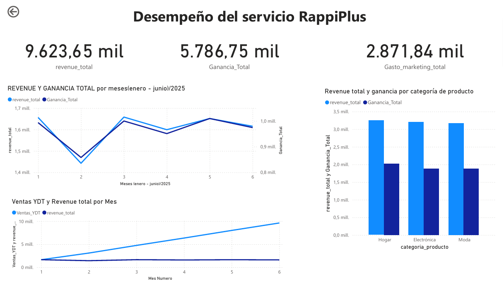
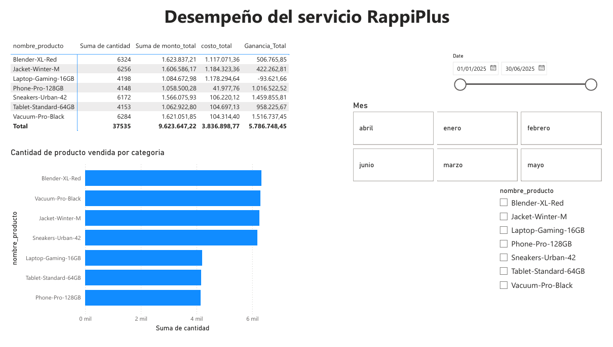
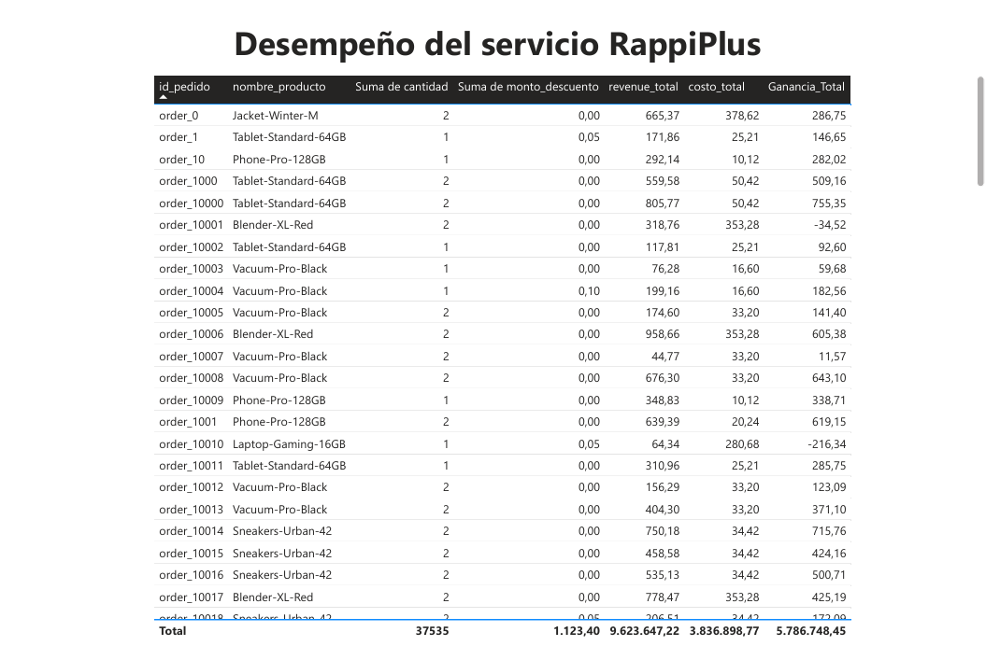

# 🛵 RappiPlus: de datos a decisiones de negocio

Análisis de punta a punta del servicio de suscripción **RappiPlus**: desde la limpieza de datos crudos hasta un dashboard en Power BI, pasando por análisis de rentabilidad, funnel de conversión, retención por cohortes y un test A/B.

> **Nota sobre los datos:** este es un caso de estudio académico con **datos simulados**. "RappiPlus" se usa solo como escenario de negocio: las cifras no provienen de Rappi ni representan su desempeño real.


---

## 🎯 Objetivo

Evaluar el desempeño de RappiPlus y responder cinco preguntas de negocio con datos:

| # | Pregunta | Herramienta |
|---|----------|-------------|
| 1 | ¿Podemos confiar en los datos? | Python (pandas) |
| 2 | ¿El negocio es rentable? | Python (pandas, matplotlib, seaborn) |
| 3 | ¿Dónde se pierden los usuarios? | SQL (PostgreSQL) |
| 4 | ¿Los usuarios regresan? | SQL — retención por cohortes |
| 5 | ¿El nuevo checkout mejora la conversión? | Test estadístico (Chi²) |
| 6 | ¿Cómo comunicamos los resultados? | Dashboard en Power BI |

---

## 📂 Estructura del repositorio

```
├── README.md
├── Proyecto_Rappi Plus.ipynb      # Limpieza, KPIs, funnel, cohortes y test A/B
├── Visualización_Rappi Plus.pbix  # Dashboard interactivo en Power BI
└── images/                        # Capturas del dashboard
```

---

## 🗃️ Datos

| Fuente | Contenido |
|--------|-----------|
| `rappiplus_orders_raw.csv` | Pedidos, precios, descuentos y revenue (25.100 filas) |
| `rappiplus_catalog.csv` | Costos, categorías y proveedores de productos |
| `rappiplus_marketing_spend.csv` | Inversión diaria en marketing por canal y país (1.620 filas) |
| `events`, `users`, `user_activity` (SQL) | Comportamiento de usuarios en la plataforma |
| `experiment_checkout_ui.csv` | Resultados del experimento A/B en el checkout (10.000 usuarios) |

Periodo analizado: **enero – junio de 2025** · Países: **Colombia, México y Argentina**.

Los montos se presentan en las unidades del dataset, que no especifica moneda.

---

## 🔍 Metodología

### 1. Calidad de datos
- Eliminación de **100 filas duplicadas** exactas.
- Tratamiento de **valores centinela** y **outliers** en `cantidad` (valores de 10.000 y 20.000).
- Imputación de nulos: **moda** para categóricas y **mediana** para numéricas.
- Conversión de fechas, estandarización de nombres de países y formatos de montos.
- Exportación de datasets limpios para el dashboard.

### 2. Rentabilidad
Unión de pedidos con catálogo para calcular costos y margen, y cruce con el gasto de marketing para obtener el profit.

### 3. Funnel de conversión
Usuarios únicos por evento con SQL, en el orden `first_visit → add_to_cart → select_item → add_payment_info → purchase`.

### 4. Retención por cohortes
Cohortes mensuales según fecha de registro y retención en las semanas 1, 2 y 3.

### 5. Test A/B
- **H₀:** no hay diferencia en la tasa de conversión entre control y tratamiento.
- **H₁:** sí hay diferencia.
- Prueba **Chi² de independencia**, α = 0,05.

---

## 📊 Resultados clave

### 💰 El negocio es rentable

| KPI | Valor |
|-----|-------|
| Ingreso total | 9.623.647 |
| Costo de productos | 3.836.899 |
| Ganancia bruta (ingreso − costo) | 5.786.748 |
| Inversión en marketing | 2.871.843 |
| **Profit** | **2.914.904 (≈ 30,3 % del ingreso)** |
| Ticket promedio por orden | 5.910 |
| Productos promedio por orden | 2 |
| Producto más vendido | Blender-XL-Red (6.324 uds.) |
| Producto menos vendido | Phone-Pro-128GB (4.148 uds.) |

Paid Search concentra la mayor inversión en marketing, aunque los tres canales (paid search, organic y social) están bastante equilibrados.

### 🛒 La mayor fuga está en el pago

| Etapa | Usuarios | Conversión vs. etapa anterior |
|-------|---------:|------------------------------:|
| first_visit | 7.796 | — |
| add_to_cart | 7.439 | 95,4 % |
| select_item | 7.052 | 94,8 % |
| add_payment_info | 5.506 | **78,1 %** |
| purchase | 4.276 | 77,7 % |

**Conversión global: 54,9 %.** El mayor abandono ocurre entre `select_item` y `add_payment_info` (−1.546 usuarios).

### 🔁 Retención estable entre cohortes

| Cohorte | Usuarios | Semana 1 | Semana 2 | Semana 3 |
|---------|---------:|---------:|---------:|---------:|
| 2025-01 | 1.627 | 85 % | 77 % | 63 % |
| 2025-02 | 1.444 | 87 % | 80 % | 65 % |
| 2025-03 | 1.636 | 87 % | 80 % | 65 % |
| 2025-04 | 1.606 | 87 % | 79 % | 64 % |
| 2025-05 | 1.687 | 86 % | 78 % | 64 % |

Cerca de 2 de cada 3 usuarios siguen activos en la tercera semana, con un comportamiento muy similar entre cohortes.

### 🧪 El nuevo checkout no tiene un efecto significativo

| Variante | Usuarios | Conversiones | Tasa |
|----------|---------:|-------------:|-----:|
| Control | 4.965 | 779 | 15,7 % |
| Tratamiento | 5.035 | 820 | 16,3 % |

χ² = 0,618 · **p = 0,432 > 0,05** → no se rechaza H₀. La leve mejora del tratamiento no es estadísticamente significativa.

---

## 📈 Dashboard en Power BI

El archivo `Visualización_Rappi Plus.pbix` contiene un modelo con las tablas `orders`, `catalog`, `marketing` y una dimensión de fechas (`Dim_Fecha`), y tres páginas:

### 1. Resumen ejecutivo
Tarjetas de revenue, ganancia y gasto en marketing; evolución mensual de revenue y ganancia; ventas acumuladas (YTD); revenue y ganancia por categoría de producto.



### 2. Productos
Matriz de cantidad, monto, costo y ganancia por producto, y unidades vendidas por producto, con filtros por fecha, mes y producto.



### 3. Detalle de pedidos
Tabla a nivel de pedido con descuentos, revenue, costo y ganancia.



**Lo que muestra el dashboard:**
- **Febrero** es el mes con menor revenue y ganancia; el resto del semestre se mantiene estable, alrededor de 1,6 millones mensuales.
- **Hogar** es la categoría con mayor revenue y ganancia, seguida de cerca por Electrónica y Moda.
- **Laptop-Gaming-16GB es el único producto con ganancia negativa (−93.622):** su costo supera lo que genera en ventas.

---

## 💡 Recomendaciones

1. **Revisar el precio o el costo de Laptop-Gaming-16GB**, que hoy genera pérdidas.
2. **Optimizar el paso de pago:** simplificar el formulario, ofrecer más métodos de pago o guardar los datos del usuario, ya que ahí se pierde el mayor volumen de usuarios.
3. **Aumentar el valor del pedido:** con 2 productos por orden en promedio, hay espacio para venta cruzada, paquetes y promociones por volumen.
4. **No escalar aún el nuevo checkout:** su mejora no es significativa; conviene iterar el diseño o ampliar la muestra antes de decidir.
5. **Reforzar la retención entre la semana 2 y 3**, donde se observa la mayor caída, con incentivos o comunicaciones de reactivación.
6. **Medir el retorno por canal de marketing** para decidir si la mayor inversión en Paid Search está justificada.

---

## ▶️ Cómo reproducirlo

```bash
pip install pandas numpy matplotlib seaborn scipy sqlalchemy psycopg2-binary jupyter
jupyter notebook "Proyecto_Rappi Plus.ipynb"
```

> Los análisis de funnel y cohortes usan una base de datos PostgreSQL de práctica que requiere credenciales de acceso.

Para el dashboard, abre `Visualización_Rappi Plus.pbix` con [Power BI Desktop](https://powerbi.microsoft.com/desktop/).

---

## 👩‍💻 Autora

**Natalia Viloria** · Data Analyst
📧 natalia.viloria2@gmail.com
🔗 [LinkedIn](https://www.linkedin.com/in/natalia-j-viloria-p%C3%A9rez-845b695a)
